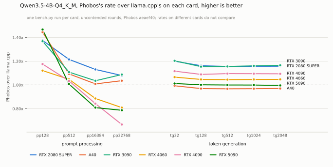

# Benchmarks

Phobos offers `phobos-bench` which measures prompt processing (pp) and
token generation (tg) throughput.

See [details](#details) for information on how to run these benchmarks locally.
`scripts/bench.py` measures Phobos and llama.cpp interleaved, and checks the
card for contention first.


Qwen3.5-0.8B-Q8_0 on an RTX 2080 SUPER, driver 617.14, tokens per second:

| test    |  llama.cpp CUDA[^1] |          Phobos GPU |
| ------- | ------------------: | ------------------: |
| pp128   |  6991.08 +/-  43.35 | 10334.94 +/- 579.27 |
| pp512   | 11640.44 +/-  14.96 | 16072.52 +/- 130.00 |
| pp16384 |  9964.82 +/-  11.53 | 12207.19 +/-  10.70 |
| pp32768 |  8174.82 +/-   7.77 |  9511.43 +/-   2.80 |
| tg32    |   222.65 +/-   0.33 |   343.36 +/-   0.83 |
| tg128   |   238.64 +/-   0.29 |   343.23 +/-   0.54 |
| tg512   |   241.67 +/-   0.27 |   342.76 +/-   0.23 |
| tg1024  |   240.16 +/-   1.28 |   343.34 +/-   0.10 |
| tg2048  |   239.78 +/-   0.57 |   341.01 +/-   0.17 |

MiniCPM5-1B-Q8_0 on an RTX 2080 SUPER, driver 617.14, tokens per second:

| test    |  llama.cpp CUDA[^1] |          Phobos GPU |
| ------- | ------------------: | ------------------: |
| pp128   |  8203.17 +/-  61.58 | 13166.33 +/- 287.01 |
| pp512   | 15340.72 +/-  76.18 | 18264.80 +/- 268.44 |
| pp16384 |  9266.64 +/-  14.57 |  9052.49 +/-  28.72 |
| pp32768 |  6273.28 +/-   9.81 |  5949.86 +/-  10.32 |
| tg32    |   250.26 +/-   8.93 |   309.53 +/-   1.29 |
| tg128   |   260.15 +/-   0.55 |   309.64 +/-   0.51 |
| tg512   |   259.05 +/-   0.59 |   308.62 +/-   0.47 |
| tg1024  |   258.09 +/-   0.60 |   306.09 +/-   0.61 |
| tg2048  |   255.77 +/-   0.56 |   300.89 +/-   0.83 |

Qwen3.5-4B-Q4_K_M on an RTX 2080 SUPER, driver 617.14, tokens per second:

| test    | llama.cpp CUDA[^1] |         Phobos GPU |
| ------- | -----------------: | -----------------: |
| pp128   | 2374.28 +/-   6.15 | 3277.73 +/-  13.66 |
| pp512   | 3144.23 +/-   5.85 | 3801.21 +/-   7.71 |
| pp16384 | 2774.98 +/-   5.41 | 3122.89 +/-   8.52 |
| pp32768 | 2422.30 +/-   3.72 | 2604.49 +/-   5.20 |
| tg32    |  101.90 +/-   0.22 |  121.90 +/-   0.43 |
| tg128   |  104.85 +/-   0.19 |  121.78 +/-   0.30 |
| tg512   |  105.34 +/-   0.19 |  121.54 +/-   0.48 |
| tg1024  |  105.12 +/-   0.20 |  121.62 +/-   0.33 |
| tg2048  |  104.63 +/-   0.22 |  121.03 +/-   0.31 |

GLM-4.6V-Flash-Q4_K_M, text only, on an RTX 2080 SUPER, driver 617.14, tokens per second:

| test  | llama.cpp CUDA[^1] | Phobos GPU         |
| ----- | -----------------: | -----------------: |
| pp128 | 1681.87 +/-   1.42 | 1546.50 +/-   4.26 |
| pp512 | 1937.30 +/-   2.04 | 1763.64 +/-   2.02 |
| tg128 |   61.94 +/-   0.04 |   59.86 +/-   0.01 |

Qwen3.8-27B-UD-IQ1_M on an RTX 2080 SUPER, driver 617.14, tokens per second:

| test  | llama.cpp CUDA[^1] | Phobos GPU      |
| ----- | -----------------: | --------------: |
| pp128 |   480.84 +/-  1.28 | 641.09 +/- 2.84 |
| tg128 |    21.26 +/-  0.00 |  30.92 +/- 0.01 |

Ternary-Bonsai-2-27B-PTQ1_0 on an RTX 2080 SUPER, driver 617.14, tokens per second:

| test  | llama.cpp-prism CUDA[^2] |        Phobos GPU |
| ----- | -----------------------: | ----------------: |
| pp128 |        468.46 +/-   1.00 | 697.47 +/-  13.85 |
| tg128 |         46.61 +/-   1.52 |  45.40 +/-   0.13 |

The two 27B models need 6.27 GiB (IQ1_M) and 5.53 GiB (PTQ1_0) for their
weights, which leaves little of the card's 8 GiB. Their numbers only hold while
the desktop uses little VRAM. If the desktop uses much more, the model no
longer fits and the driver pages it over PCIe. An earlier session measured
that at 7 t/s.

The smaller models', Bonsai's and the MiniCPM-V Q8_0's tables are from the
2026-10-23 run at dbaa4f7. The MiniCPM-V Q4_K_M table is from an earlier run
that day at aeaef40, which runs the same code on this card. The GLM, Qwen3.8
and Qwen3.6 tables are from 2026-10-16, when 837 MiB was in use before the
runs.

On 2026-10-23 the desktop held 0.9 to 1.4 GiB, and in both of that day's runs
one engine paged on each of those three models. Phobos's GLM pp512 fell from
1,764 t/s at 837 MiB to between 60 and 845. llama.cpp's Qwen3.8 pp128 fell to
2 to 9 t/s. Its Qwen3.6 pp512 fell to between 70 and 176 t/s, and in the later
run its MiniCPM-V Q4_K_M pp512 fell to between 131 and 154.

## Across Cards

Qwen3.5-4B-Q4_K_M ran on seven cards on 2026-10-23: the 2080 SUPER above,
and six cards rented through vast.ai under Linux. Each ran the same `bench.py`
sizes as the tables above against llama.cpp b11681, five rounds, all of them
uncontended. Every card ran dbaa4f7 except the 3090, which ran c5f210f later
that day; the two run the same engine code.



Phobos's rate over llama.cpp's on each card:

| card | power limit | pp128 | pp512 | pp16384 | pp32768 | tg128 | tg2048 |
| --- | ---: | ---: | ---: | ---: | ---: | ---: | ---: |
| RTX 2080 SUPER | 250 W | 1.38x | 1.21x | 1.13x | 1.08x | 1.16x | 1.16x |
| A40 | 300 W | 1.43x | 1.10x | 1.01x | 1.04x | 0.98x | 0.98x |
| RTX 3090 | 350 W | 1.30x | 1.07x | 0.99x | 1.00x | 1.06x | 1.06x |
| RTX 4060 | 115 W | 1.11x | 1.04x | 0.95x | 0.93x | 1.05x | 1.05x |
| RTX 4090 | 450 W | 1.25x | 1.08x | 0.95x | 1.00x | 1.08x | 1.08x |
| H100 PCIe | 350 W | 1.28x | 1.08x | 0.93x | 0.88x | 1.18x | 1.18x |
| RTX 5090 | 575 W | 1.52x | 1.01x | 0.85x | 0.90x | 0.98x | 0.97x |

A ratio compares the two engines on one card in one session. The rates
themselves do not compare across cards, since the hosts differ and so do the
power limits they set, though every rented card here ran at its stock limit. Each card's rates, its kernel benchmark and
where it ran are on the
[supported platforms](https://phobos-lang.dev/docs/getting-started/platforms/)
page, from `results/platforms/`.

A short prompt runs faster on Phobos on every card. At 16k and 32k tokens the
2080 SUPER and the A40 stay ahead of llama.cpp, and the 3090 and the 4090 are
level at 32k. The 4060, the H100 and the 5090 are 5 to 15% behind there.
Decode is within 3% of llama.cpp or ahead on every card, at 0.97x to 1.18x.

`bench.py` reports the clock under load against the card's maximum. Two
rentals were replaced because the driver slowed them for heat: an H100 SXM at
64% of its maximum clock and a 3090 at 70%. A 4090 held at 65% by heat read
0.67x at pp32768 in an earlier run, where a healthy one reads 1.00x. A
power limit moves the ratio too: an earlier 3090 capped at 260 W read 1.09x
at pp32768 and 1.15x on decode, where this one at its stock 350 W reads 1.00x
and 1.06x.

## Mixture of Experts

Qwen3.6-35B-A3B-UD-Q4_K_M, a mixture of 256 experts whose 19.5 GB do not fit the card, on an RTX 2080 SUPER, driver 617.14, tokens per second:

| test  | llama.cpp CUDA[^1], `-ncmoe 31 -t 8` | Phobos GPU        |
| ----- | -----------------------------------: | ----------------: |
| pp128 |                      72.61 +/-  0.74 | 246.89 +/- 41.10  |
| pp512 |                     255.99 +/-  2.44 | 634.16 +/-  8.62  |
| tg128 |                      31.34 +/-  0.07 |  53.60 +/-  0.64  |

Phobos's pp128 on Qwen3.6 took 208, 203 and 329 t/s in its three rounds. A
128-token prompt touches few experts, so the rate depends on which ones the
cache already holds when it starts.
The Qwen3.6 rows were measured before `phobos-bench` emptied the expert cache and used a new token sequence for each repetition. Every repetition then reused the same tokens over a cache already holding their experts, which favours Phobos; later runs report the hit rate beside each repetition.

MiniCPM-V-4.7-35B-A3B-Q4_K_M, text only, the same architecture, on an RTX 2080 SUPER, driver 617.14, tokens per second:

| test  | llama.cpp CUDA[^1], `-ncmoe 30 -t 8` |        Phobos GPU |
| ----- | -----------------------------------: | ----------------: |
| pp128 |                     82.41 +/-   0.47 | 301.03 +/-  13.63 |
| pp512 |                    255.86 +/-   2.16 | 625.75 +/-  10.32 |
| tg128 |                     32.65 +/-   0.39 |  63.03 +/-   0.36 |

MiniCPM-V-4.7-35B-A3B-Q8_0, text only, on an RTX 2080 SUPER, driver 617.14, tokens per second:

| test  | llama.cpp CUDA[^1], `-ncmoe 36 -t 8` |        Phobos GPU |
| ----- | -----------------------------------: | ----------------: |
| pp128 |                     35.35 +/-   1.14 | 192.62 +/-   2.08 |
| pp512 |                    139.37 +/-   1.17 | 463.03 +/-   4.88 |
| tg128 |                     19.11 +/-   0.03 |  32.21 +/-   1.61 |

Both engines keep everything except the experts on the GPU. They differ in
where the experts go.

**llama.cpp** decides at load time which layers keep their experts on the CPU.
We swept `llama-bench` at a 3k context for each model and kept one layer of
margin above the lowest setting that does not page:

- `-ncmoe 31` on Qwen3.6: experts of the first 31 layers on the CPU. At 30 its
  prompt rate drops by a third, and at 29 it pages.
- `-ncmoe 30` on the MiniCPM-V Q4_K_M, which is 0.9 GiB smaller. 29 is a few
  percent faster, but 28 pages.
- `-ncmoe 36` on the MiniCPM-V Q8_0. 34 and below page.
- `-t 8`: 6 to 16 threads measure the same on the Q8_0, and the default (24)
  decoded 12% slower in an earlier session.

**Phobos** keeps a cache of experts on the GPU, sized so the context still has
room to grow.

- Decode: experts in the cache run on the GPU. At the same time, CPU threads
  compute the missing experts from host memory. That takes a quarter of the
  time copying the expert to the GPU would. The CPU hands its results to the
  GPU through mapped memory.
- Prompt processing: Phobos copies experts to the GPU over PCIe and computes
  the rest on the CPU at the same time.

The link on this machine is PCIe 3.0 x8, 6.4 GB/s.

## Real-World Load

The tables above come from a synthetic benchmark. `scripts/agent_bench.py`
measures a real workload instead:

1. It runs the [pi](https://pi.dev) coding agent on the tasks in `bench/` and
   records every request the agent sends.
2. It replays the recording to each engine, with every answer capped at its
   recorded length. Both engines get the same prompts in the same order. Each
   keeps its session between requests and rewinds it to where the next prompt
   differs.

The model is Qwen3.6-35B-A3B. Both engines use the same sampler, a 32k
context and one slot. llama.cpp fits its expert split to the card itself, the
way `llama-server` does by default, with `-t 8` on the 2080 SUPER. One
recording of each task in `bench/`, made on 2026-10-23, replayed three rounds
each, without thinking, at c5f210f:

| task      | requests | engine         | wall    | prompt  | decode   | tokens/round |
| --------- | -------: | -------------- | ------: | ------: | -------: | -----------: |
| `fib`     |        7 | llama.cpp CUDA |  72.8 s | 179 t/s | 26.5 t/s |          722 |
|           |          | Phobos GPU     |  81.6 s | 264 t/s | 36.2 t/s |        1,855 |
| `law`     |        4 | llama.cpp CUDA |  38.1 s | 194 t/s | 27.4 t/s |          225 |
|           |          | Phobos GPU     |  95.1 s | 165 t/s | 37.6 t/s |        1,260 |
| `pelican` |        2 | llama.cpp CUDA | 170.1 s | 221 t/s | 24.1 t/s |        3,506 |
|           |          | Phobos GPU     | 137.6 s | 449 t/s | 41.2 t/s |        4,764 |

The replay caps each answer at its recorded length, but it cannot make an
engine keep going, and both sample. llama.cpp ends its answers early here,
writing 4,453 tokens a round to Phobos's 7,879, so the wall times cover
different amounts of work. The rates are per token and compare as they are.

The context grows to 8.2k tokens on `fib`, 11.1k on `law` and 9.8k on
`pelican`. That is why decode is slower here than in the benchmark tables.

### Across cards

The same recording, replayed once to each engine on five cards, the others
rented through vast.ai. The rented cards ran dd9deb9, and the 2080 SUPER's row
is the table above:

| card | memory | llama.cpp's experts | prompt, Phobos | prompt, llama.cpp | decode, Phobos | decode, llama.cpp |
| --- | ---: | --- | ---: | ---: | ---: | ---: |
| RTX 2080 SUPER | 8 GB | 34 of 40 layers' experts in host memory | 246 t/s | 194 t/s | 39.3 t/s | 24.6 t/s |
| RTX 4060 | 8 GB | 33 of 40 layers' experts in host memory | 65 t/s | 83 t/s | 6.1 t/s | 6.1 t/s |
| RTX 3090 | 24 GB | all on the card | 749 t/s | 2,853 t/s | 108.7 t/s | 140.1 t/s |
| RTX 4090 | 24 GB | all on the card | 1,529 t/s | 4,607 t/s | 121.2 t/s | 124.5 t/s |
| A40 | 48 GB | all on the card | 596 t/s | 2,710 t/s | 81.3 t/s | 96.5 t/s |

On the cards too small for the model, llama.cpp keeps most layers' experts in
host memory and Phobos streams them through its cache. On the 2080 SUPER that
makes Phobos 1.3x faster on prompts and 1.6x on decode. The rented 4060's host
ran llama.cpp with 6 threads, and both engines decoded at 6.1 t/s there.

On a card that holds the whole model, both engines keep every expert on it.
Decode comes within 3% to 22% of llama.cpp, and llama.cpp's prompt processing
is 3x to 4.5x faster. Before dd9deb9 Phobos held at most 79 experts a block on
any card, and on the 4090 it decoded at 77.5 t/s.

The rented 3090 ran at its stock 350 W, and the 4090 at 350 W of its 450.

An earlier session replayed an 8-request `fib` recording with thinking:

| thinking         | wall    | prompt    | decode     | tokens/round |
| ---------------- | ------: | --------: | ---------: | -----------: |
| llama.cpp CUDA   | 149.1 s | 105 t/s   | 30.1 t/s   |        2,005 |
| Phobos GPU       | 147.8 s | 193 t/s   | 42.0 t/s   |       ~4,400 |

With thinking, the two wall times cover different amounts of work. llama.cpp
ends the long reasoning turn early, so Phobos writes about twice as many tokens
in the same time.

## Under Memory Pressure

A desktop does not leave the card alone. A browser, a game or a second model
can take a share of its memory at any time. This replays the `fib` recording
above, and before the fourth of its 14 requests another process takes 2 GiB of
the card's 8 and keeps writing to it until the task ends. Both engines loaded
against the whole card. Three rounds each, median wall time:

| engine         | wall    | prompt  | decode   |
| -------------- | ------: | ------: | -------: |
| llama.cpp CUDA | 352.3 s | 32 t/s  |  6.4 t/s |
| Phobos GPU     |  96.6 s | 183 t/s | 33.5 t/s |

The same rates split at the squeeze, the mean over rounds:

| engine         | decode before | decode after | kept | prompt before | prompt after |
| -------------- | ------------: | -----------: | ---: | ------------: | -----------: |
| llama.cpp CUDA |      29.8 t/s |      6.7 t/s |  23% |       129 t/s |       23 t/s |
| Phobos GPU     |      40.7 t/s |     32.3 t/s |  80% |       292 t/s |      138 t/s |

llama.cpp lands in one of two states under the squeeze. In two of the three
rounds it decoded at 8.5 t/s after the squeeze began, and in the third at
3.3 t/s, which took that round 844 s.

llama.cpp can buy room for the squeeze up front. With the experts of five more
layers on the CPU (`-ncmoe 36`), it doesn't notice the squeeze at all, but it
is slower without one, too:

| engine                      | wall    | decode before | decode after | prompt before | prompt after |
| --------------------------- | ------: | ------------: | -----------: | ------------: | -----------: |
| llama.cpp CUDA, `-ncmoe 36` | 130.4 s |      26.8 t/s |     26.5 t/s |       117 t/s |      107 t/s |

**llama.cpp** fixed its split at load time. When the card runs out of memory,
the driver pages its buffers to host memory, and every token reads them back
over PCIe.

**Phobos** checks the whole card's free memory between passes. When another
process fills the card, the expert cache gives the memory back, here in three
steps from 41 to 8 or 9 experts a block. More misses go to the CPU threads, but
nothing is paged. When the memory is free again, the cache takes it back.

Without the squeeze, Phobos replays this trace in 74.9 s.

The other program can also close again. In this run the squeeze starts
before the third request and ends before the sixth. Phobos three rounds,
llama.cpp five, median wall time and the mean decode rate over rounds:

| engine         | wall    | decode before | during   | after    |
| -------------- | ------: | ------------: | -------: | -------: |
| llama.cpp CUDA | 372.7 s |      29.3 t/s |  5.6 t/s | 19.3 t/s |
| Phobos GPU     |  81.4 s |      44.2 t/s | 33.2 t/s | 43.1 t/s |

Phobos recovers every time: its cache grows from 8 back to 39 experts a block
once the squeeze ends. llama.cpp recovered in two of its five rounds, decoding
at 8.6 t/s during the squeeze and 29 t/s after it, in about 176 s. In the other
three it decoded at 3.5 t/s during the squeeze and only 12 to 14 t/s after it,
in about 380 s.

The raw results are `results/agent-squeeze.json`, `results/agent-squeeze-ncmoe36.json`
and `results/agent-squeeze-release.json`.

## Details

`bench.py` probes every `llama*` build next to the checkout, so each run names
the one it compares against with `--llama-bench`.

The 0.8B, MiniCPM5-1B and 4B tables come from one run of both engines.

```bash
python scripts/bench.py -p 128 512 16384 32768 -n 32 128 512 1024 2048 -r 3 -R 5 \
  --llama-bench ${llama_cpp}/llama-bench.exe --csv results/bench.csv --json results/bench.json
```

GLM-4.6V-Flash fills most of the card, so it measures two prompt sizes and one
generation size.

```bash
python scripts/bench.py -m models/GLM-4.6V-Flash-Q4_K_M.gguf -p 128 512 -n 128 \
  -r 3 -R 3 --llama-bench ${llama_cpp}/llama-bench.exe \
  --csv results/bench-glm.csv --json results/bench-glm.json
```

The Qwen 27B is slow, so this run uses fewer sizes and repetitions. It is also
close to the card's memory limit, so it measures only one prompt size and one
generation size.

```bash
python scripts/bench.py -m models/Qwen3.8-27B-UD-IQ1_M.gguf -p 128 -n 128 \
  -r 1 -R 3 --llama-bench ${llama_cpp}/llama-bench.exe \
  --csv results/bench-qwen38.csv --json results/bench-qwen38.json
```

The ternary 27B, against PrismML's llama.cpp fork.

```bash
python scripts/bench.py -m models/Ternary-Bonsai-2-27B-PTQ1_0.gguf -p 128 -n 128 \
  -r 1 -R 3 --llama-bench ${llama_cpp_prism}/llama-bench.exe \
  --csv results/bench-bonsai.csv --json results/bench-bonsai.json
```

The 35B mixture of experts models, each with the llama.cpp setting from
[Mixture of Experts](#mixture-of-experts).

```bash
python scripts/bench.py -m models/Qwen3.6-35B-A3B-UD-Q4_K_M.gguf -p 128 512 -n 128 \
  -r 1 -R 3 --llama-bench ${llama_cpp}/llama-bench.exe --llama-args="-ncmoe 31 -t 8" \
  --csv results/bench-qwen36moe.csv --json results/bench-qwen36moe.json
python scripts/bench.py -m models/MiniCPM-V-4_7-35B-A3B-Q4_K_M.gguf -p 128 512 -n 128 \
  -r 1 -R 3 --llama-bench ${llama_cpp}/llama-bench.exe --llama-args="-ncmoe 30 -t 8" \
  --csv results/bench-minicpmv-q4.csv --json results/bench-minicpmv-q4.json
python scripts/bench.py -m models/MiniCPM-V-4_7-35B-A3B-Q8_0.gguf -p 128 512 -n 128 \
  -r 1 -R 3 --llama-bench ${llama_cpp}/llama-bench.exe --llama-args="-ncmoe 36 -t 8" \
  --csv results/bench-minicpmv-q8.csv --json results/bench-minicpmv-q8.json
```

The sweep behind each setting, here for the Q8_0:

```bash
llama-bench -m models/MiniCPM-V-4_7-35B-A3B-Q8_0.gguf -p 512 -n 128 -d 3072 -t 8 -r 2 \
  -ncmoe 33,34,35,36,37,38
```

Record a [pi](https://pi.dev) session of every task, then replay it to both
engines and plot the result. A rented card replays the same recording with
`scripts/vastai/agent.sh`, which `VASTAI.md` describes.

```bash
python scripts/agent_bench.py --engines phobos -r 1 --ctx 32768 --out RUN [--thinking]
python scripts/agent_bench.py -r 3 --ctx 32768 [--thinking] --replay RUN/phobos-rep1-*.requests.jsonl \
  --llama-arg=-t --llama-arg=8 --out REPLAY
cp REPLAY/results.json results/agent.json
python scripts/plot_agent.py results/agent.json -o results/agent.svg --context \
  "Qwen3.6-35B-A3B-UD-Q4_K_M on an RTX 2080 SUPER, phobos c5f210f, llama.cpp b11681 fit -t 8, 32k context, no thinking"
```

The same replay with 2 GiB of the card taken by another process from the
fourth request on. `--squeeze-at 3 --squeeze-until 6` takes it before the
third request and gives it back before the sixth.

```bash
python scripts/agent_bench.py -r 3 --replay RUN/phobos-rep1-fib.requests.jsonl --squeeze \
  --llama-arg=-ncmoe --llama-arg=31 --llama-arg=-t --llama-arg=8
```

Producing the SVG for the results.

```bash
python scripts/plot.py results/bench.json results/bench-glm.json results/bench-qwen38.json \
  results/bench-bonsai.json results/bench-qwen36moe.json results/bench-minicpmv-q4.json \
  results/bench-minicpmv-q8.json -o results/inference.svg
```

Each rented card runs `scripts/vastai/platform.sh`, which `VASTAI.md`
describes; its files land in `results/platforms/`. The chart across cards:

```bash
python scripts/plot_platforms.py -o results/platforms.svg
```

Manually invoking the engines (not a comparison).

```bash
llama-bench -p 512 -n 128 -m ${models}/Qwen3.5-0.8B-Q8_0.gguf -r 10
cargo run --features cuda --release -p phobos-bench -- -m ${models}/Qwen3.5-0.8B-Q8_0.gguf -p 512 -n 128 -r 10
```

Measuring cuBLAS/GEMM performance. It's a separate benchmark that autotunes the
kernels.

```bash
cargo run -r -p phobos-kbench -- --csv results/results.csv
python scripts/plot_bench.py results/results.csv -o results/bench.svg
```

A GEMM row is timed between CUDA events around the kernel alone, with C
restored outside them, Phobos and cuBLAS launched alternately, and reports
the median of the interleaved rounds. Each kind is compared with the cuBLAS
call that computes the same thing:

| kind | A, B | C | multiply | accumulate | cuBLAS |
|---|---|---|---|---|---|
| `gemm_fp32`, `gemm_fp32_unaligned`, `gemm_fp32_splitk` | f32 | f32 | f32 | f32 | `cublasSgemm` |
| `gemm_fp16_fp32acc` | f16 | f32 | f16 tensor cores | f32 | `cublasGemmEx` 16F/32F, `COMPUTE_32F` |
| `gemm_fp16tc_fp32acc` | f32, rounded while staging | f32 | f16 tensor cores | f32 | the same, after converting A and B, the conversion timed in |
| `gemm_fp16` | f16 | f16 | f16 tensor cores | f16 | `cublasGemmEx` 16F/16F, `COMPUTE_16F` |

`--suite` runs each kind's compact problem set (squares, GPT-2's projections
at 512 tokens, small M with a long k, and sizes no tile divides), `--shape
MxNxK` picks problems, and `--json` keeps every timing, winner, resource
count, correctness check and the environment. Winners are remembered per
card, driver, compiler and source; `--retune` ignores them.

```bash
cargo run -r -p phobos-kbench -- --bench gemm_fp32 --suite --retune --json gemm_fp32.json
python scripts/kbench_table.py gemm_fp32.json
```

[^1]: build: 5e03a1ff4 (11681)
[^2]: [PrismML's llama.cpp fork](https://github.com/PrismML-Eng/llama.cpp), build: e3de71522 (10777)
