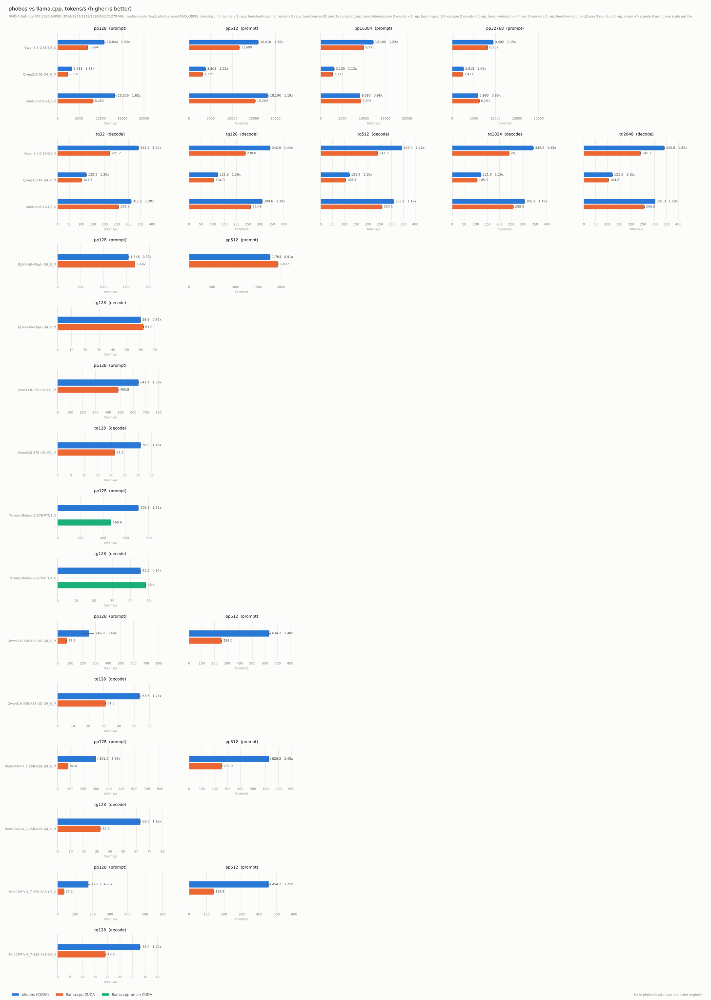
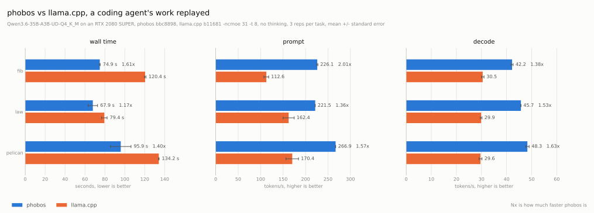
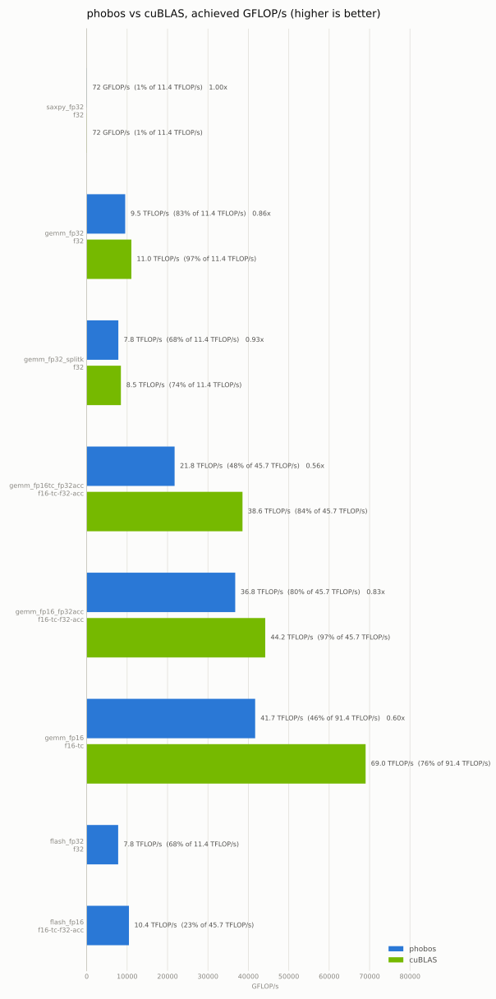

# Benchmarks

Phobos offers `phobos-bench` which measures prompt processing (pp) and
token generation (tg) throughput.

See [details](#details) for information on how to run these benchmarks locally.
`scripts/bench.py` measures Phobos and llama.cpp interleaved, and checks the
card for contention first.







Qwen3.5-0.8B-Q8_0 on an RTX 2080 SUPER, driver 617.14, tokens per second:

| test   | llama.cpp CUDA[^1]  | Phobos GPU          |
| ------ | ------------------: | ------------------: |
| pp128  |  7064.41 +/-  47.47 |  9272.97 +/- 244.51 |
| pp512  | 11727.05 +/-  44.16 | 13188.90 +/-  91.65 |
| tg32   |   221.97 +/-   0.61 |   343.64 +/-   1.67 |
| tg128  |   238.48 +/-   0.54 |   343.73 +/-   1.15 |
| tg512  |   241.68 +/-   0.52 |   343.62 +/-   1.00 |
| tg1024 |   241.34 +/-   0.53 |   343.28 +/-   0.89 |
| tg2048 |   239.38 +/-   1.14 |   341.18 +/-   0.89 |

MiniCPM5-1B-Q8_0 on an RTX 2080 SUPER, driver 617.14, tokens per second:

| test   | llama.cpp CUDA[^1]  | Phobos GPU          |
| ------ | ------------------: | ------------------: |
| pp128  |  8080.83 +/- 152.45 |  9869.60 +/- 113.65 |
| pp512  | 15224.11 +/- 134.20 | 12579.49 +/-  39.49 |
| tg32   |   260.00 +/-   0.50 |   312.11 +/-   0.93 |
| tg128  |   261.04 +/-   0.69 |   310.34 +/-   0.78 |
| tg512  |   259.81 +/-   0.44 |   309.22 +/-   0.66 |
| tg1024 |   257.25 +/-   1.35 |   307.00 +/-   0.71 |
| tg2048 |   255.75 +/-   0.62 |   302.19 +/-   0.76 |

Qwen3.5-4B-Q4_K_M on an RTX 2080 SUPER, driver 617.14, tokens per second:

| test   | llama.cpp CUDA[^1] | Phobos GPU         |
| ------ | -----------------: | -----------------: |
| pp128  | 2380.58 +/-   4.04 | 3299.90 +/-  17.01 |
| pp512  | 3137.20 +/-   0.97 | 3676.09 +/-   3.19 |
| tg32   |  101.56 +/-   0.05 |  121.87 +/-   0.41 |
| tg128  |  104.53 +/-   0.05 |  121.54 +/-   0.28 |
| tg512  |  105.04 +/-   0.10 |  121.60 +/-   0.26 |
| tg1024 |  104.76 +/-   0.08 |  121.36 +/-   0.31 |
| tg2048 |  104.33 +/-   0.07 |  120.93 +/-   0.25 |

GLM-4.6V-Flash-Q4_K_M, text only, on an RTX 2080 SUPER, driver 617.14, tokens per second:

| test  | llama.cpp CUDA[^1] | Phobos GPU         |
| ----- | -----------------: | -----------------: |
| pp128 | 1681.87 +/-   1.42 | 1546.50 +/-   4.26 |
| pp512 | 1937.30 +/-   2.04 | 1763.64 +/-   2.02 |
| tg128 |   61.94 +/-   0.04 |   59.86 +/-   0.01 |

Qwen3.8-27B-UD-IQ1_M on an RTX 2080 SUPER, driver 617.14, tokens per second:

| test  | llama.cpp CUDA[^1] | Phobos GPU      |
| ----- | -----------------: | --------------: |
| pp128 |   480.84 +/-  1.28 | 641.09 +/- 2.84 |
| tg128 |    21.26 +/-  0.00 |  30.92 +/- 0.01 |

Ternary-Bonsai-2-27B-PTQ1_0 on an RTX 2080 SUPER, driver 617.14, tokens per second:

| test  | llama.cpp-prism CUDA[^2] | Phobos GPU       |
| ----- | -----------------------: | ---------------: |
| pp128 |         467.43 +/-  2.10 | 677.29 +/-  3.56 |
| tg128 |          48.44 +/-  0.02 |  45.61 +/-  0.08 |

The two 27B models need 6.27 GiB (IQ1_M) and 5.53 GiB (PTQ1_0) for their
weights, which leaves little of the card's 8 GiB. Their numbers only hold while
the desktop uses little VRAM: 837 MiB was in use before both runs. If the
desktop uses much more, the model no longer fits and the driver pages it over
PCIe. An earlier session measured that at 7 t/s.

## Mixture of Experts

Qwen3.6-35B-A3B-UD-Q4_K_M, a mixture of 256 experts whose 19.5 GB do not fit the card, on an RTX 2080 SUPER, driver 617.14, tokens per second:

| test  | llama.cpp CUDA[^1], `-ncmoe 31 -t 8` | Phobos GPU        |
| ----- | -----------------------------------: | ----------------: |
| pp128 |                      72.61 +/-  0.74 | 246.89 +/- 41.10  |
| pp512 |                     255.99 +/-  2.44 | 634.16 +/-  8.62  |
| tg128 |                      31.34 +/-  0.07 |  53.60 +/-  0.64  |

Phobos's pp128 on Qwen3.6 took 208, 203 and 329 t/s in its three rounds. A
128-token prompt touches few experts, so the rate depends on which ones the
cache already holds when it starts.

MiniCPM-V-4.7-35B-A3B-Q4_K_M, text only, the same architecture, on an RTX 2080 SUPER, driver 617.14, tokens per second:

| test  | llama.cpp CUDA[^1], `-ncmoe 30 -t 8` | Phobos GPU       |
| ----- | -----------------------------------: | ---------------: |
| pp128 |                      82.14 +/-  0.53 | 213.94 +/- 1.19  |
| pp512 |                     282.32 +/-  0.36 | 703.43 +/- 6.70  |
| tg128 |                      32.58 +/-  0.82 |  67.01 +/- 0.22  |

MiniCPM-V-4.7-35B-A3B-Q8_0, text only, on an RTX 2080 SUPER, driver 617.14, tokens per second:

| test  | llama.cpp CUDA[^1], `-ncmoe 36 -t 8` | Phobos GPU       |
| ----- | -----------------------------------: | ---------------: |
| pp128 |                      34.96 +/-  0.05 | 212.14 +/- 3.24  |
| pp512 |                     139.88 +/-  0.63 | 482.48 +/- 9.39  |
| tg128 |                      19.47 +/-  0.05 |  38.84 +/- 0.50  |

Both engines keep everything except the experts on the GPU. They differ in
where the experts go.

**llama.cpp** decides at load time which layers keep their experts on the CPU.
We swept `llama-bench` at a 3k context for each model and kept one layer of
margin above the lowest setting that does not page:

- `-ncmoe 31` on Qwen3.6: experts of the first 31 layers on the CPU. At 30 its
  prompt rate drops by a third, and at 29 it pages.
- `-ncmoe 30` on the MiniCPM-V Q4_K_M, which is 0.9 GiB smaller. 29 is a few
  percent faster, but 28 pages.
- `-ncmoe 36` on the MiniCPM-V Q8_0. 34 and below page.
- `-t 8`: 6 to 16 threads measure the same on the Q8_0, and the default (24)
  decoded 12% slower in an earlier session.

**Phobos** keeps a cache of experts on the GPU, sized so the context still has
room to grow.

- Decode: experts in the cache run on the GPU. At the same time, CPU threads
  compute the missing experts from host memory. That takes a quarter of the
  time copying the expert to the GPU would. The CPU hands its results to the
  GPU through mapped memory.
- Prompt processing: Phobos copies experts to the GPU over PCIe and computes
  the rest on the CPU at the same time.

The link on this machine is PCIe 3.0 x8, 6.4 GB/s.

## Real-World Load

The tables above come from a synthetic benchmark. `scripts/agent_bench.py`
measures a real workload instead:

1. It runs the [pi](https://pi.dev) coding agent on the tasks in `bench/` and
   records every request the agent sends.
2. It replays the recording to each engine, with every answer capped at its
   recorded length. Both engines get the same prompts in the same order. Each
   keeps its session between requests and rewinds it to where the next prompt
   differs.

The model is Qwen3.6-35B-A3B. Both engines use the same sampler, a 16k context
and one slot, and llama.cpp uses the settings above. One recording of each task
in `bench/`, replayed three rounds each, without thinking:

| task      | requests | engine         | wall    | prompt  | decode   |
| --------- | -------: | -------------- | ------: | ------: | -------: |
| `fib`     |       14 | llama.cpp CUDA | 120.4 s | 113 t/s | 30.5 t/s |
|           |          | Phobos GPU     |  74.9 s | 226 t/s | 42.2 t/s |
| `law`     |        3 | llama.cpp CUDA |  79.4 s | 162 t/s | 29.9 t/s |
|           |          | Phobos GPU     |  67.9 s | 222 t/s | 45.7 t/s |
| `pelican` |        2 | llama.cpp CUDA | 134.2 s | 170 t/s | 29.6 t/s |
|           |          | Phobos GPU     |  95.9 s | 267 t/s | 48.3 t/s |

The replay caps each answer at its recorded length, but it cannot make an
engine keep going, and both sample. A round of `fib` has Phobos write 2,200
tokens to llama.cpp's 2,261, `law` 1,375 to 1,029 and `pelican` 3,501 to
3,089, so the wall times cover slightly different amounts of work. The rates
are per token and compare as they are.

The context grows to 5.5k tokens on `fib`, 8.5k on `law` and 6.3k on `pelican`.
That is why decode is slower here than in the benchmark tables.

An earlier session replayed an 8-request `fib` recording with thinking:

| thinking         | wall    | prompt    | decode     | tokens/round |
| ---------------- | ------: | --------: | ---------: | -----------: |
| llama.cpp CUDA   | 149.1 s | 105 t/s   | 30.1 t/s   |        2,005 |
| Phobos GPU       | 147.8 s | 193 t/s   | 42.0 t/s   |       ~4,400 |

With thinking, the two wall times cover different amounts of work. llama.cpp
ends the long reasoning turn early, so Phobos writes about twice as many tokens
in the same time.

## Under Memory Pressure

A desktop does not leave the card alone. A browser, a game or a second model
can take a share of its memory at any time. This replays the `fib` recording
above, and before the fourth of its 14 requests another process takes 2 GiB of
the card's 8 and keeps writing to it until the task ends. Both engines loaded
against the whole card. Three rounds each, median wall time:

| engine         | wall    | prompt  | decode   |
| -------------- | ------: | ------: | -------: |
| llama.cpp CUDA | 352.3 s | 32 t/s  |  6.4 t/s |
| Phobos GPU     |  96.6 s | 183 t/s | 33.5 t/s |

The same rates split at the squeeze, the mean over rounds:

| engine         | decode before | decode after | kept | prompt before | prompt after |
| -------------- | ------------: | -----------: | ---: | ------------: | -----------: |
| llama.cpp CUDA |      29.8 t/s |      6.7 t/s |  23% |       129 t/s |       23 t/s |
| Phobos GPU     |      40.7 t/s |     32.3 t/s |  80% |       292 t/s |      138 t/s |

llama.cpp lands in one of two states under the squeeze. In two of the three
rounds it decoded at 8.5 t/s after the squeeze began, and in the third at
3.3 t/s, which took that round 844 s.

llama.cpp can buy room for the squeeze up front. With the experts of five more
layers on the CPU (`-ncmoe 36`), it doesn't notice the squeeze at all, but it
is slower without one, too:

| engine                      | wall    | decode before | decode after | prompt before | prompt after |
| --------------------------- | ------: | ------------: | -----------: | ------------: | -----------: |
| llama.cpp CUDA, `-ncmoe 36` | 130.4 s |      26.8 t/s |     26.5 t/s |       117 t/s |      107 t/s |

**llama.cpp** fixed its split at load time. When the card runs out of memory,
the driver pages its buffers to host memory, and every token reads them back
over PCIe.

**Phobos** checks the whole card's free memory between passes. When another
process fills the card, the expert cache gives the memory back, here in three
steps from 41 to 8 or 9 experts a block. More misses go to the CPU threads, but
nothing is paged. When the memory is free again, the cache takes it back.

Without the squeeze, Phobos replays this trace in 74.9 s.

The other program can also close again. In this run the squeeze starts
before the third request and ends before the sixth. Phobos three rounds,
llama.cpp five, median wall time and the mean decode rate over rounds:

| engine         | wall    | decode before | during   | after    |
| -------------- | ------: | ------------: | -------: | -------: |
| llama.cpp CUDA | 372.7 s |      29.3 t/s |  5.6 t/s | 19.3 t/s |
| Phobos GPU     |  81.4 s |      44.2 t/s | 33.2 t/s | 43.1 t/s |

Phobos recovers every time: its cache grows from 8 back to 39 experts a block
once the squeeze ends. llama.cpp recovered in two of its five rounds, decoding
at 8.6 t/s during the squeeze and 29 t/s after it, in about 176 s. In the other
three it decoded at 3.5 t/s during the squeeze and only 12 to 14 t/s after it,
in about 380 s.

The raw results are `results/agent-squeeze.json`, `results/agent-squeeze-ncmoe36.json`
and `results/agent-squeeze-release.json`.

## Details

`bench.py` probes every `llama*` build next to the checkout, so each run names
the one it compares against with `--llama-bench`.

The 0.8B, MiniCPM5-1B and 4B tables come from one run of both engines.

```bash
python scripts/bench.py -p 128 512 -n 32 128 512 1024 2048 -r 3 -R 5 \
  --llama-bench ${llama_cpp}/llama-bench.exe --csv results/bench.csv --json results/bench.json
```

GLM-4.6V-Flash fills most of the card, so it measures two prompt sizes and one
generation size.

```bash
python scripts/bench.py -m models/GLM-4.6V-Flash-Q4_K_M.gguf -p 128 512 -n 128 \
  -r 3 -R 3 --llama-bench ${llama_cpp}/llama-bench.exe \
  --csv results/bench-glm.csv --json results/bench-glm.json
```

The Qwen 27B is slow, so this run uses fewer sizes and repetitions. It is also
close to the card's memory limit, so it measures only one prompt size and one
generation size.

```bash
python scripts/bench.py -m models/Qwen3.8-27B-UD-IQ1_M.gguf -p 128 -n 128 \
  -r 1 -R 3 --llama-bench ${llama_cpp}/llama-bench.exe \
  --csv results/bench-qwen38.csv --json results/bench-qwen38.json
```

The ternary 27B, against PrismML's llama.cpp fork.

```bash
python scripts/bench.py -m models/Ternary-Bonsai-2-27B-PTQ1_0.gguf -p 128 -n 128 \
  -r 1 -R 3 --llama-bench ${llama_cpp_prism}/llama-bench.exe \
  --csv results/bench-bonsai.csv --json results/bench-bonsai.json
```

The 35B mixture of experts models, each with the llama.cpp setting from
[Mixture of Experts](#mixture-of-experts).

```bash
python scripts/bench.py -m models/Qwen3.6-35B-A3B-UD-Q4_K_M.gguf -p 128 512 -n 128 \
  -r 1 -R 3 --llama-bench ${llama_cpp}/llama-bench.exe --llama-args="-ncmoe 31 -t 8" \
  --csv results/bench-qwen36moe.csv --json results/bench-qwen36moe.json
python scripts/bench.py -m models/MiniCPM-V-4_7-35B-A3B-Q4_K_M.gguf -p 128 512 -n 128 \
  -r 1 -R 3 --llama-bench ${llama_cpp}/llama-bench.exe --llama-args="-ncmoe 30 -t 8" \
  --csv results/bench-minicpmv-q4.csv --json results/bench-minicpmv-q4.json
python scripts/bench.py -m models/MiniCPM-V-4_7-35B-A3B-Q8_0.gguf -p 128 512 -n 128 \
  -r 1 -R 3 --llama-bench ${llama_cpp}/llama-bench.exe --llama-args="-ncmoe 36 -t 8" \
  --csv results/bench-minicpmv-q8.csv --json results/bench-minicpmv-q8.json
```

The sweep behind each setting, here for the Q8_0:

```bash
llama-bench -m models/MiniCPM-V-4_7-35B-A3B-Q8_0.gguf -p 512 -n 128 -d 3072 -t 8 -r 2 \
  -ncmoe 33,34,35,36,37,38
```

Record a [pi](https://pi.dev) session of every task, then replay it to both
engines and plot the result.

```bash
python scripts/agent_bench.py --engines phobos -r 1 --out RUN [--thinking]
python scripts/agent_bench.py -r 3 [--thinking] --replay RUN/phobos-rep1-*.requests.jsonl \
  --llama-arg=-ncmoe --llama-arg=31 --llama-arg=-t --llama-arg=8 --out REPLAY
cp REPLAY/results.json results/agent.json
python scripts/plot_agent.py results/agent.json -o results/agent.svg --context \
  "Qwen3.6-35B-A3B-UD-Q4_K_M on an RTX 2080 SUPER, phobos bbc8898, llama.cpp b11681 -ncmoe 31 -t 8, no thinking"
```

The same replay with 2 GiB of the card taken by another process from the
fourth request on. `--squeeze-at 3 --squeeze-until 6` takes it before the
third request and gives it back before the sixth.

```bash
python scripts/agent_bench.py -r 3 --replay RUN/phobos-rep1-fib.requests.jsonl --squeeze \
  --llama-arg=-ncmoe --llama-arg=31 --llama-arg=-t --llama-arg=8
```

Producing the SVG for the results.

```bash
python scripts/plot.py results/bench.json results/bench-glm.json results/bench-qwen38.json \
  results/bench-bonsai.json results/bench-qwen36moe.json results/bench-minicpmv-q4.json \
  results/bench-minicpmv-q8.json -o results/inference.svg
```

Manually invoking the engines (not a comparison).

```bash
llama-bench -p 512 -n 128 -m ${models}/Qwen3.5-0.8B-Q8_0.gguf -r 10
cargo run --features cuda --release -p phobos-bench -- -m ${models}/Qwen3.5-0.8B-Q8_0.gguf -p 512 -n 128 -r 10
```

Measuring cuBLAS/GEMM performance. It's a separate benchmark that autotunes the
kernels.

```bash
cargo run -r -p phobos-kbench -- --csv results/results.csv
python scripts/plot_bench.py results/results.csv -o results/bench.svg
```

[^1]: build: 5e03a1ff4 (11681)
[^2]: [PrismML's llama.cpp fork](https://github.com/PrismML-Eng/llama.cpp), build: e3de71522 (10777)
